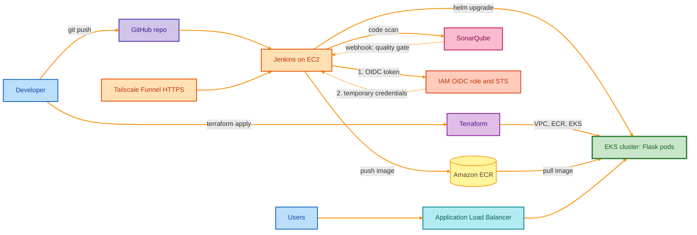
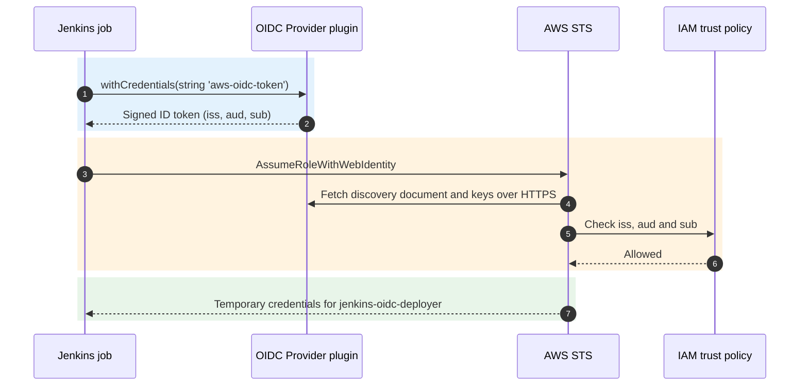

# Flask on AWS EKS: Terraform, Helm, Jenkins, SonarQube and OIDC

A Flask "Hello, World!" app deployed to Amazon EKS. Terraform builds the AWS infrastructure, Docker packages the app, and Helm defines the Kubernetes resources behind an Application Load Balancer. A **Jenkins** server on EC2 runs **SonarQube** code analysis and signs in to AWS with **OIDC**, so no AWS access keys are stored.



> The guide builds and verifies every piece above up to the OIDC login to AWS. The final Jenkins deploy stages (image push and Helm deploy) are the next step once the role has ECR and EKS permissions (see section 8).

## At a glance

| | |
| --- | --- |
| Region | `us-west-1` |
| EKS cluster | `tc2-eks` |
| Node group | `tc2-eks-nodes` (2 worker nodes) |
| ECR repository | `hello-world` |
| Kubernetes namespace and Helm release | `hello-world` |
| App port | `5000` |
| Jenkins / SonarQube ports | `8080` / `9000` |
| Jenkins IAM role | `jenkins-oidc-deployer` |

## How it works

| Component | Role |
| --- | --- |
| Terraform | Creates the VPC (public and private subnets), ECR repository and EKS cluster using the `vpc`, `ecr` and `eks` modules |
| Helm | Templates the Deployment, Service and Ingress for the app |
| ALB controller | Creates the public Application Load Balancer from the Ingress |
| Jenkins | Runs in Docker on EC2 with Docker, kubectl, Helm, AWS CLI, Trivy and SonarScanner available |
| SonarQube | Analyzes the code and reports a quality gate back to Jenkins through a webhook |
| Tailscale Funnel | Gives Jenkins a public HTTPS URL, which OIDC requires |
| IAM OIDC provider and role | Lets Jenkins assume `jenkins-oidc-deployer` with short-lived credentials |

## Prerequisites

- AWS account with CLI credentials configured (`aws configure`)
- Python, Git, Docker Desktop, Terraform, kubectl, Helm
- An EC2 key pair and the full path to its `.pem` file
- A free Tailscale account
- Commands run in Git Bash from the project root unless noted. Replace `<ACCOUNT_ID>` with your own AWS account ID.
- Commands marked **EC2** run on the Jenkins server (Ubuntu), not on your workstation.

## Repository structure

| Path | Contents |
| --- | --- |
| `app/` | Flask app: `app.py`, `requirements.txt`, `Dockerfile` (`python:3.12-slim`) |
| `eks-modules/terraform/bootstrap/` | Remote state backend |
| `eks-modules/terraform/environments/dev/` | `backend.tf`, `main.tf`, `outputs.tf`, `providers.tf`, `terraform.tfvars`, `variables.tf` |
| `eks-modules/terraform/modules/` | `vpc/`, `ecr/`, `eks/` modules |
| `helm/k8s/` | Helm chart: `Chart.yaml`, `values.yaml`, `templates/` |
| `README.md` | This file |

## Deployment

### 1. Test locally

```bash
cd app
python -m pip install -r requirements.txt
python app.py
```

Stop with **Ctrl+C**, then test the container:

```bash
docker build -t eks-proj-app .
docker run --rm -p 5000:5000 eks-proj-app
```

Open http://localhost:5000 and confirm **Hello, World!**

### 2. Provision infrastructure

```bash
aws sts get-caller-identity
cd eks-modules/terraform/environments/dev
terraform init
terraform plan
terraform apply
terraform output
```

Review the plan before applying. Save the ECR URL, VPC ID, public subnet IDs and cluster name from the output. Then connect kubectl:

```bash
aws eks update-kubeconfig --region us-west-1 --name tc2-eks
kubectl get nodes
```

Two nodes should show `Ready`.

### 3. Push the image to ECR

```bash
aws ecr get-login-password --region us-west-1 | docker login --username AWS --password-stdin <ACCOUNT_ID>.dkr.ecr.us-west-1.amazonaws.com
docker tag eks-proj-app:latest <ACCOUNT_ID>.dkr.ecr.us-west-1.amazonaws.com/hello-world:latest
docker push <ACCOUNT_ID>.dkr.ecr.us-west-1.amazonaws.com/hello-world:latest
```

The tag you push must match `image.tag` in `helm/k8s/values.yaml`, otherwise pods fail with `ImagePullBackOff`.

### 4. Install the AWS Load Balancer Controller

```bash
helm repo add eks https://aws.github.io/eks-charts
helm repo update
VPC_ID=$(aws eks describe-cluster --name tc2-eks --region us-west-1 --query "cluster.resourcesVpcConfig.vpcId" --output text)
echo "$VPC_ID"
```

Set the VPC ID on the controller. Without it the pods crash-loop:

```bash
helm upgrade aws-load-balancer-controller eks/aws-load-balancer-controller \
  --namespace kube-system \
  --reuse-values \
  --set-string vpcId="$VPC_ID" \
  --wait --timeout 5m
kubectl get deployment aws-load-balancer-controller -n kube-system
kubectl get pods -n kube-system -l app.kubernetes.io/name=aws-load-balancer-controller
```

The deployment should show `2/2`. If the controller is not installed yet, use `helm upgrade --install` with the same flags and also set `clusterName=tc2-eks`, `region=us-west-1` and your service account name.

### 5. Deploy the app with Helm

Get the public subnet IDs and put them in the `alb.ingress.kubernetes.io/subnets` annotation in `helm/k8s/values.yaml`. Confirm the image repository and that the tag is `latest`.

```bash
terraform output public_subnet_ids
helm lint helm/k8s
helm upgrade --install hello-world helm/k8s --namespace hello-world --create-namespace --wait --timeout 5m
kubectl get deployments,pods,services,ingress -n hello-world
```

Open `http://` plus the Ingress **ADDRESS**. The ALB can take a couple of minutes to become active. You should see **Hello, World!**

## CI server

### 6. Jenkins and SonarQube on EC2

#### 6.1 Launch the EC2 instance and install Docker

Launch an Ubuntu instance named `eks-pipeline-jenkins` (`t3.medium` or larger, because SonarQube needs about 2 GB free memory). In its security group allow inbound TCP `22`, `8080` and `9000` from **your IP only**.

**EC2**

```bash
chmod 400 /full/path/to/your-key.pem
ssh -i /full/path/to/your-key.pem ubuntu@<EC2_PUBLIC_IP>

sudo apt-get update && sudo apt-get upgrade -y
sudo apt-get install -y curl unzip ca-certificates gnupg jq
sudo install -m 0755 -d /etc/apt/keyrings
sudo curl -fsSL https://download.docker.com/linux/ubuntu/gpg -o /etc/apt/keyrings/docker.asc
sudo chmod a+r /etc/apt/keyrings/docker.asc
echo "deb [arch=$(dpkg --print-architecture) signed-by=/etc/apt/keyrings/docker.asc] https://download.docker.com/linux/ubuntu $(. /etc/os-release && echo $VERSION_CODENAME) stable" | sudo tee /etc/apt/sources.list.d/docker.list > /dev/null
sudo apt-get update
sudo apt-get install -y docker-ce docker-ce-cli containerd.io docker-buildx-plugin docker-compose-plugin
sudo systemctl enable --now docker
sudo usermod -aG docker $USER && newgrp docker
docker run --rm hello-world
```

#### 6.2 Run Jenkins with the CLI tools it needs

Pipeline steps run **inside** the Jenkins container, so the tools must be inside it. Start a plain container, install the tools as root, then save it as a new image.

**EC2**

```bash
docker run -d --name jenkins -p 8080:8080 -p 50000:50000 -v jenkins_home:/var/jenkins_home jenkins/jenkins:lts
docker exec -u root -it jenkins bash
```

Inside the container:

```bash
apt-get update
apt-get install -y ca-certificates curl unzip gnupg docker.io python3 python3-venv

# AWS CLI
curl -fsSL https://awscli.amazonaws.com/awscli-exe-linux-x86_64.zip -o /tmp/aws.zip
unzip -q /tmp/aws.zip -d /tmp && /tmp/aws/install

# kubectl
curl -fsSL https://dl.k8s.io/release/v1.34.1/bin/linux/amd64/kubectl -o /usr/local/bin/kubectl
chmod +x /usr/local/bin/kubectl

# Helm
curl -fsSL https://get.helm.sh/helm-v3.19.0-linux-amd64.tar.gz -o /tmp/helm.tar.gz
tar -xzf /tmp/helm.tar.gz -C /tmp && install /tmp/linux-amd64/helm /usr/local/bin/helm

# Trivy
curl -fsSL https://aquasecurity.github.io/trivy-repo/deb/public.key -o /tmp/trivy.key
gpg --batch --yes --dearmor -o /usr/share/keyrings/trivy.gpg /tmp/trivy.key
echo "deb [signed-by=/usr/share/keyrings/trivy.gpg] https://aquasecurity.github.io/trivy-repo/deb generic main" > /etc/apt/sources.list.d/trivy.list
apt-get update && apt-get install -y trivy

# SonarScanner
curl -fsSL https://binaries.sonarsource.com/Distribution/sonar-scanner-cli/sonar-scanner-cli-7.2.0.5079-linux-x64.zip -o /tmp/sonar.zip
unzip -q /tmp/sonar.zip -d /opt
ln -s /opt/sonar-scanner-7.2.0.5079-linux-x64/bin/sonar-scanner /usr/local/bin/sonar-scanner

git --version && docker --version && aws --version && kubectl version --client && helm version && trivy --version && sonar-scanner --version
exit
```

Back on the host, save the image and restart Jenkins with Docker socket access:

**EC2**

```bash
docker stop jenkins
docker rename jenkins jenkins-before-socket
docker commit jenkins-before-socket jenkins-tools:1
DOCKER_GID=$(stat -c '%g' /var/run/docker.sock)
docker run -d --name jenkins --restart unless-stopped \
  --group-add "$DOCKER_GID" \
  -p 8080:8080 \
  -v jenkins_home:/var/jenkins_home \
  -v /var/run/docker.sock:/var/run/docker.sock \
  jenkins-tools:1
docker exec --user jenkins jenkins docker version
```

The last command should print both a Client and a Server section. Keep the `jenkins_home` volume whenever you recreate the container so the OIDC signing keys survive.

#### 6.3 Unlock Jenkins and install plugins

```bash
docker exec jenkins cat /var/jenkins_home/secrets/initialAdminPassword
```

Open `http://<EC2_PUBLIC_IP>:8080`, paste the password and create your admin user. Then go to **Manage Jenkins → Plugins → Available plugins** and install:

| Plugin | Note |
| --- | --- |
| SonarQube Scanner | Sends analysis to SonarQube |
| OpenID Connect Provider | Plugin ID `oidc-provider`. Do **not** pick "OpenID Connect Authentication" |
| Credentials Binding | Normally already installed |

#### 6.4 Run SonarQube

**EC2**

```bash
sudo sysctl -w vm.max_map_count=524288
sudo sysctl -w fs.file-max=131072
echo "vm.max_map_count=524288" | sudo tee -a /etc/sysctl.conf
echo "fs.file-max=131072" | sudo tee -a /etc/sysctl.conf
free -h
docker network create ci
docker network connect ci jenkins
docker run -d --name sonarqube --restart unless-stopped --network ci -p 9000:9000 \
  -v sonarqube_data:/opt/sonarqube/data \
  -v sonarqube_extensions:/opt/sonarqube/extensions \
  -v sonarqube_logs:/opt/sonarqube/logs \
  sonarqube:community
docker logs -f sonarqube
docker exec jenkins curl -s http://sonarqube:9000/api/system/status
```

Wait for `SonarQube is operational` and `"status":"UP"`. Then open `http://<EC2_PUBLIC_IP>:9000`, log in with `admin` / `admin` and set a new password.

In SonarQube:

1. **Projects → Create Project → Local project**. Name `Flask EKS App`, key `flask-eks-app`, branch `main`.
2. **My Account → Security → Generate Tokens**. Name `jenkins-sonarqube-token`, type Project Analysis Token. Copy it.

#### 6.5 Connect Jenkins to SonarQube

| Where in Jenkins | Setting |
| --- | --- |
| **Manage Jenkins → Credentials → Global → Add** | Kind `Secret text`, ID `sonarqube-token`, secret = your token |
| **Manage Jenkins → System → SonarQube servers** | Name `SonarQube`, URL `http://sonarqube:9000`, token `sonarqube-token` |
| **Manage Jenkins → Tools → SonarQube Scanner** | Name `SonarScanner`, install automatically |

Create a Pipeline job named `sonarqube-test` and run this to prove the connection:

```groovy
pipeline {
  agent any
  stages {
    stage('Create Test Python File') {
      steps {
        writeFile file: 'sonar_test.py',
          text: "def hello():\n    return 'Hello from Jenkins'\n"
      }
    }
    stage('SonarQube Analysis') {
      steps {
        script {
          def scannerHome = tool 'SonarScanner'
          withSonarQubeEnv('SonarQube') {
            sh """
              "${scannerHome}/bin/sonar-scanner" \
                -Dsonar.projectKey=flask-eks-app \
                -Dsonar.sources=sonar_test.py \
                -Dsonar.python.version=3
            """
          }
        }
      }
    }
  }
}
```

The console should end with `ANALYSIS SUCCESSFUL` and `Finished: SUCCESS`.

#### 6.6 Add the quality gate webhook

```bash
openssl rand -hex 24
```

1. **SonarQube → Administration → Configuration → Webhooks → Create.** Name `Jenkins-Quality-Gate`, URL `http://jenkins:8080/sonarqube-webhook/` (trailing slash required), secret = the value above.
2. **Jenkins → Credentials → Add.** Kind `Secret text`, ID `sonarqube-webhook-secret`, same secret.
3. **Jenkins → System → SonarQube servers → Advanced.** Set **Webhook Secret** to `sonarqube-webhook-secret`.
4. Add this stage after the analysis stage and run the job:

```groovy
stage('Quality Gate') {
  steps {
    timeout(time: 5, unit: 'MINUTES') {
      waitForQualityGate abortPipeline: true
    }
  }
}
```

If SonarQube rejects the webhook URL as a private address, recreate the container with `-e SONAR_VALIDATEWEBHOOKS=false` (data stays in the volumes).

### 7. HTTPS and OIDC login to AWS

Order that works: **HTTPS, Jenkins OIDC, AWS IAM, trust policy, authentication test.**



#### 7.1 Public HTTPS with Tailscale Funnel

**EC2**

```bash
curl -fsSL https://tailscale.com/install.sh | sh
sudo tailscale up
tailscale status
sudo tailscale funnel --bg 8080
tailscale funnel status
```

Approve the device and Funnel in the links Tailscale prints. Open the HTTPS URL (`https://<TS_HOST>.ts.net/`) and confirm the Jenkins login page loads. Then set **Manage Jenkins → System → Jenkins URL** to that address. After HTTPS works, remove the public port 8080 rule from the security group.

#### 7.2 Jenkins OIDC credential

**Manage Jenkins → Credentials → Global → Add:**

| Field | Value |
| --- | --- |
| Kind | OpenID Connect id token |
| ID | `aws-oidc-token` |
| Audience | `sts.amazonaws.com` |
| Issuer URI | Leave empty |

Open the credential and click **Update** to read the issuer URL (`https://<TS_HOST>.ts.net/oidc`). This kind is a **text** credential, so the Jenkinsfile must bind it with `string(...)`, never `file(...)`.

#### 7.3 AWS IAM

1. **IAM → Identity providers → Add provider.** Type OpenID Connect, URL `https://<TS_HOST>.ts.net/oidc`, audience `sts.amazonaws.com`.
2. **IAM → Roles → Create role.** Web identity, select that provider, audience `sts.amazonaws.com`, name `jenkins-oidc-deployer`. No permissions are needed for the first test.
3. Create a Pipeline job named `jenkins-oidc-pipeline` (no spaces in the name).
4. Edit the role's trust policy:

```json
{
  "Version": "2012-10-17",
  "Statement": [
    {
      "Effect": "Allow",
      "Principal": {
        "Federated": "arn:aws:iam::<ACCOUNT_ID>:oidc-provider/<TS_HOST>.ts.net/oidc"
      },
      "Action": "sts:AssumeRoleWithWebIdentity",
      "Condition": {
        "StringEquals": {
          "<TS_HOST>.ts.net/oidc:aud": "sts.amazonaws.com",
          "<TS_HOST>.ts.net/oidc:sub": "https://<TS_HOST>.ts.net/job/jenkins-oidc-pipeline/"
        }
      }
    }
  ]
}
```

The `sub` value must match the real `sub` claim in the issued token and restricts the role to that one job.

#### 7.4 Test the login

Paste this into the `jenkins-oidc-pipeline` job and click **Build Now**:

```groovy
pipeline {
  agent any
  environment {
    AWS_ROLE_ARN = 'arn:aws:iam::<ACCOUNT_ID>:role/jenkins-oidc-deployer'
    AWS_DEFAULT_REGION = 'us-west-1'
    AWS_EC2_METADATA_DISABLED = 'true'
  }
  stages {
    stage('Test AWS OIDC Authentication') {
      steps {
        withCredentials([string(credentialsId: 'aws-oidc-token', variable: 'OIDC_TOKEN')]) {
          sh '''
            set +x
            set -eu
            umask 077
            TOKEN_FILE=$(mktemp)
            trap 'rm -f "$TOKEN_FILE"' EXIT
            printf '%s' "$OIDC_TOKEN" > "$TOKEN_FILE"
            export AWS_WEB_IDENTITY_TOKEN_FILE="$TOKEN_FILE"
            unset AWS_ACCESS_KEY_ID AWS_SECRET_ACCESS_KEY AWS_SESSION_TOKEN AWS_PROFILE
            aws sts get-caller-identity
          '''
        }
      }
    }
  }
}
```

Success looks like an ARN containing `assumed-role/jenkins-oidc-deployer/`. Jenkins has authenticated with no stored AWS keys.

### 8. Next: the full Jenkins pipeline

| Stage | Purpose |
| --- | --- |
| SonarQube scan and quality gate | Block bad code before it is built |
| Docker build | Package the app, tagged with the build ID |
| Trivy scan | Check the image for known vulnerabilities |
| OIDC login | Get temporary AWS credentials (section 7.4) |
| Push to ECR | Store the image |
| Helm deploy | `helm upgrade --install` into EKS with the new tag |

Before adding these stages, attach ECR and EKS permissions to `jenkins-oidc-deployer` (least privilege) and create an EKS access entry for the role so Jenkins can run kubectl and Helm.

## Troubleshooting

| Symptom | Likely cause | Fix |
| --- | --- | --- |
| ALB controller pods in `CrashLoopBackOff` | `vpcId` empty in Helm values | `helm upgrade --reuse-values --set vpcId=<VPC_ID>` |
| `ImagePullBackOff` | Helm tag not in ECR | Match the `values.yaml` tag to ECR, then `helm upgrade --install` |
| `Permission denied (publickey)` | Wrong key path or permissions | `chmod 400` and use the full path with `ssh -i` |
| SonarQube page will not load | Security group lacks port 9000 for your IP | Fix the inbound rule |
| SonarQube container exits | Kernel settings or low memory | Set `vm.max_map_count` and `fs.file-max`; keep about 2 GB free |
| Quality Gate stage hangs | Webhook missing, wrong URL or secret mismatch | Check the trailing slash, the shared secret and the `ci` network |
| `FileCredentials was expected` | `file()` used for a text credential | Use `string()` |
| `AccessDenied` from STS | Trust policy mismatch | Check `iss`, `aud` and `sub` |
| `InvalidIdentityToken` | AWS cannot validate the issuer or keys | Verify HTTPS and the discovery document |
| `aws: not found` in Jenkins | CLI not inside the container | Rebuild `jenkins-tools` with the tool installed |

Useful checks:

```bash
kubectl logs -n kube-system deployment/aws-load-balancer-controller --all-containers=true --previous --tail=80
kubectl get events -n hello-world
aws ecr list-images --repository-name hello-world --region us-west-1
tailscale funnel status
docker network inspect ci
```

## Cleanup

Remove the Helm releases first. This deletes the ALB so the VPC can be destroyed:

```bash
helm uninstall hello-world -n hello-world
helm uninstall aws-load-balancer-controller -n kube-system
sudo tailscale funnel reset
docker stop jenkins sonarqube
cd eks-modules/terraform/environments/dev
terraform destroy
```

Empty the ECR repository first if it still holds images. Then terminate the Jenkins EC2 instance, delete the `jenkins-oidc-deployer` role and the Jenkins identity provider in IAM, and remove the device from Tailscale.

## Security notes

- Never commit access keys, the SonarQube token, the webhook secret, `*.tfstate`, `*.tfvars` or `.pem` files.
- Funnel exposes Jenkins publicly: keep authentication on, disable anonymous admin access and close public port 8080 once HTTPS works.
- Scope the Jenkins role to the specific job through `sub` and grant only the ECR and EKS permissions it needs.
